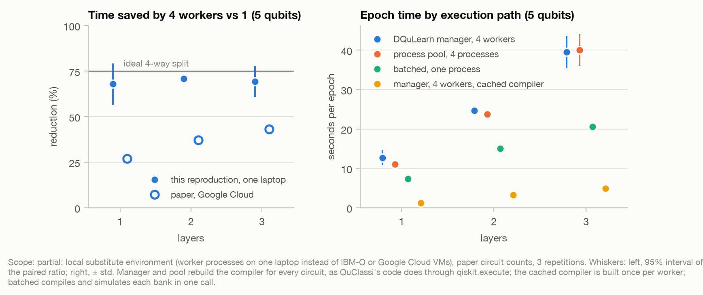
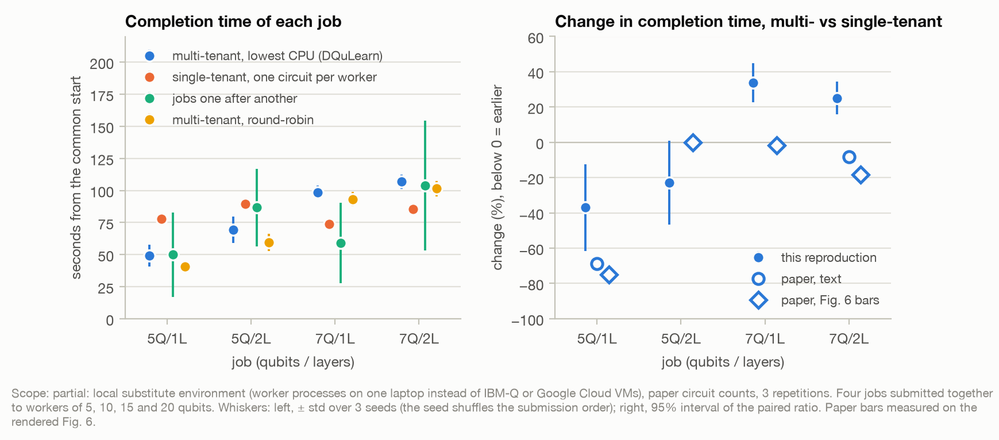
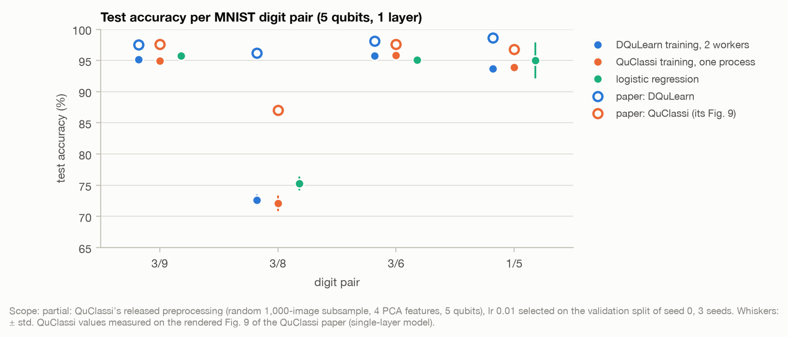

# Distributed Quantum Learning with co-Management in a Multi-tenant Quantum System - Reproduction

Status: experiments done (phase 03): results and their comparison with the paper are below; photonic adaptation, documentation and notebook come next.

## Reference and Attribution

- Paper: "Distributed Quantum Learning with co-Management in a Multi-tenant Quantum System" (IEEE BigData 2023)
- Authors: Anthony D'Onofrio Jr., Amir Hossain, Lesther Santana, Naseem Machlovi, Samuel Stein, Jinwei Liu, Ang Li, Ying Mao
- arXiv: [2312.08158](https://arxiv.org/abs/2312.08158) (v1, 13 Dec 2023; cs.DC)
- Original repository: none linked by the paper. The paper adopts its circuits from the open-source QuClassi code (Stein et al., "QuClassi: A hybrid deep neural network architecture based on quantum state fidelity", MLSys 2022) and gives no URL for it.
- License and attribution notes: cite the paper above when reusing this reproduction.

## Overview

DQuLearn trains a hybrid quantum-classical classifier on several small quantum machines instead of one large one. Its workload is QuClassi, a classifier based on quantum-state fidelity; parameter-shift gradients turn each training epoch into a bank of independent circuits. A co-Manager sends each circuit to a registered worker that has more free qubits than the circuit needs and the lowest classical resource usage. The paper reports accuracy on four MNIST digit pairs, the runtime of one epoch with 1, 2 and 4 workers, and the gain from serving four clients at once (multi-tenancy), with simulators as workers.

This reproduction runs the paper's QuClassi workload (ported from QuClassi's released code to Qiskit 2.x) through a local co-Manager (Algorithm 2) and worker processes reached over RPyC, plus fair execution baselines.

## How to Run

### Install dependencies

```bash
python -m venv .venv
source .venv/bin/activate
pip install -r requirements.txt
```

### Command-line interface

Main entry point: the repo-level `implementation.py`. The CLI is entirely described in `cli.json`, so updating/adding arguments does not require editing Python code.

```bash
# From inside papers/DQuLearn
python ../../implementation.py --help

# From the repo root
python implementation.py --paper DQuLearn --help
```

Main flags (see `cli.json` for the authoritative list): `--config PATH`, `--seed INT`, `--qubits`, `--layers`, `--workers`, `--worker-qubits`, `--backend` (`manager`, `pool`, `batched`, `local`), `--mode` (multi-tenant: `multi`, `single`, `sequential`), `--policy` (`least_cpu`, `round_robin`), `--compile-mode`, `--cpu-slots`, `--pair`, `--lr`, `--epochs`, `--update-rule`, `--shift-schedule`, `--circuits-per-epoch`, `--exact`, and the diagnostic `--latency-seconds` (a fixed wait per circuit on each worker). The device must be `cpu`.

Example runs, from the repository root:

```bash
# Smoke run (defaults): one 80-circuit epoch through the co-Manager and 2 workers
python implementation.py --paper DQuLearn

# Worker scaling at the paper's circuit count (Fig. 5): 4 workers, 2 layers
python implementation.py --paper DQuLearn --config configs/worker_scaling_original.json --workers 4 --layers 2

# Multi-tenant (Fig. 6): four concurrent clients on workers of 5, 10, 15 and 20 qubits
python implementation.py --paper DQuLearn --config configs/multi_tenant_original.json

# Accuracy on a digit pair (Sec. IV-B), 2 workers, exact probabilities
python implementation.py --paper DQuLearn --config configs/accuracy_original.json --pair 3,8
```

From inside `papers/DQuLearn`, use `python ../../implementation.py` with the same flags.

The script saves a snapshot of the resolved config alongside results and logs.

### Reproduce the results

Each experiment is a sweep of repeated runs described by a spec in `utils/sweep_specs/`: `worker_scaling_5q`, `worker_scaling_7q`, `multi_tenant`, `multi_tenant_variants_rerun`, `multi_tenant_latency`, `accuracy_lr_selection`, `accuracy_final` (written after the learning-rate selection), `accuracy_parity`, `accuracy_shots`, `accuracy_diagnostics`, `accuracy_feature_ceiling`. From the repository root:

```bash
# One sweep, written to papers/DQuLearn/outdir/sweep_<id>/; --validator takes the experiment-logging validate_logging.py
python papers/DQuLearn/utils/run_sweep.py papers/DQuLearn/utils/sweep_specs/worker_scaling_5q.json --validator <path to validate_logging.py>

# Result tables and figures in results/
python papers/DQuLearn/utils/build_results.py --sweeps papers/DQuLearn/outdir --results papers/DQuLearn/results
python papers/DQuLearn/utils/plot_worker_scaling.py --sweep papers/DQuLearn/outdir/sweep_worker_scaling_5q
python papers/DQuLearn/utils/plot_multi_tenant.py --sweep papers/DQuLearn/outdir/sweep_multi_tenant
python papers/DQuLearn/utils/plot_accuracy.py --sweep papers/DQuLearn/outdir/sweep_accuracy_final

# Gap diagnosis
python papers/DQuLearn/utils/diagnose_accuracy_gap.py --sweeps papers/DQuLearn/outdir --results papers/DQuLearn/results
python papers/DQuLearn/utils/diagnose_runtime_gaps.py --sweeps papers/DQuLearn/outdir --results papers/DQuLearn/results
```

Runtime sweeps measure wall-clock time: run them one at a time, on a machine that stays otherwise idle and awake (on a laptop, keep the lid open).

### Data

The paper uses MNIST and links its original page, which no longer serves the files. This reproduction uses the copy that QuClassi's released code loads (`tf.keras.datasets.mnist.load_data()`): the full training (60,000 images) and test (10,000 images) splits, identical to the original MNIST files and in the same order (checked against torchvision's copies). MNIST is copyright Yann LeCun and Corinna Cortes, under the CC BY-SA 3.0 licence (as stated in the Keras loader). Download it from the repository root (11.5 MB, git-ignored):

```bash
mkdir -p data/DQuLearn/MNIST
curl -fsSL -o data/DQuLearn/MNIST/mnist.npz https://storage.googleapis.com/tensorflow/tf-keras-datasets/mnist.npz
shasum -a 256 data/DQuLearn/MNIST/mnist.npz  # expect 731c5ac602752760c8e48fbffcf8c3b850d9dc2a2aedcf2cc48468fc17b673d1
```

### Data location and shared code

- The shared data root defaults to the repository's `data/` folder; each paper is scoped to a subfolder named after the paper, here `data/DQuLearn/`. The runner resolves this via `runtime_lib.data_paths.paper_data_dir`, so you usually just pass `--paper` or set `dataset.root` to `null` and downloads land in the right place.
- Override the base root with `DATA_DIR=/abs/path` or `--data-root /abs/path` when calling `implementation.py`; the paper subfolder is appended automatically.
- Reusable helpers can live under `papers/shared/`; import them from the paper code to avoid duplication.

### Output directory and generated files

At each run, a timestamped folder is created under the base `outdir` (default: `outdir`):

```
outdir/run_YYYYMMDD-HHMMSS/
├── config_snapshot.json   # Resolved configuration used for the run
├── run.log                # Lifecycle, progress and evaluation events
├── run_status.json        # Run status, code and data identity, evidence hashes
├── metrics.json           # Structured results
└── worker-<i>.log         # One log per worker process (manager backend)
```

Notes:
- Change the base output directory with `--outdir` or in `configs/defaults.json` (key `outdir`).
- `outdir/` is ignored by Git (repository `.gitignore`).

## Configuration

Place configuration files in `configs/`.

- `defaults.json`: a lightweight smoke run; every named config overlays it. Named configs: `worker_scaling_original.json` and its `_pool_baseline` and `_batched_baseline` variants; `multi_tenant_original.json`, `multi_tenant_single_tenant.json`, `multi_tenant_sequential_jobs.json`, `multi_tenant_round_robin.json`, `multi_tenant_fig6_job_sizes.json` and the diagnostic `multi_tenant_latency_bound.json`; `accuracy_original.json`, `accuracy_quclassi_reference.json`, `accuracy_classical.json`, `accuracy_shots.json`; smoke sizes `multi_tenant_reduced.json` and `accuracy_reduced.json`. Each file's `description` says what it runs.
- `cli.json` declares the CLI arguments, their types, and the config keys they mutate.
- The shared runtime automatically loads `configs/defaults.json`, `cli.json`, and calls `lib/runner.py::train_and_evaluate`, so keep that entry point in every project.
- Any config value named `dtype` is normalized into a `(label, torch.dtype)` pair at runtime via `runtime_lib.dtypes`, so you can inspect both the requested string and the resolved `torch.dtype` without duplicating conversion logic.
- Keys typically include: dataset, model, training, evaluation, logging.
- Precision control: add a top-level `"dtype"` entry (mirrors `"seed"`) to force the entire pipeline (datasets + models) to run in a specific torch dtype; individual models may still expose a `model.dtype` override if required.

**Placeholder guard:** If any config value still contains a `<<...>>` placeholder (e.g., `"teacher_path": "<<TEACHER_PATH>>"`), the shared runner aborts early with a clear error. Replace these placeholders with real paths/values before launching a run.

## Results and Analysis

Scope labels:
- Runtime results are **partial**: worker processes on one laptop instead of IBM-Q or Google Cloud VMs, at the paper's circuit counts (except the latency diagnostic, at one tenth of Fig. 6's job sizes), 3 repetitions.
- Accuracy results are **partial**: QuClassi's released preprocessing (a random 1,000-image subsample, 4 PCA features on 5 qubits), learning rate 0.01 chosen on the validation split of seed 0 alone (34–42 images per pair), 3 seeds.
- The 10,000-shot accuracy run is **preliminary**: one pair, one seed.

Paper values come from its text, or from bars measured on its rendered figures ("bars"). The full tables are in `results/`, built from the sweeps by the commands under "Reproduce the results".

### Worker scaling (Sec. IV-C2, Fig. 5)



Epoch time saved by 4 workers instead of 1, 5 qubits (95% interval over 3 repetitions):

| Layers | This reproduction | Paper (Google Cloud, text) |
|---|---|---|
| 1 | 67.9% [56.6, 79.3] | 27.1% |
| 2 | 70.8% [69.7, 72.0] | 37.3% |
| 3 | 69.4% [60.8, 78.0] | 43.2% |

- The trend is reproduced (more workers, shorter epochs; 69.6–71.3% at 7 qubits), the magnitude is not: ours is close to the ideal 75%. The paper's own numbers imply about 0.17 s per circuit that did not run in parallel, against about 2 ms here (`results/runtime_gaps.md`): a difference of execution environment, not of method.
- Against a plain process pool with the same workers, the DQuLearn manager's epoch time differs by at most 6.2% in eight of nine cells, in both directions; the ninth (4 workers, 1 layer) is too noisy to tell (ratio 1.16 [0.59, 1.72]). Running each circuit bank as one simulator job in a single process is 39–50% faster than the manager with 4 workers (5 and 7 qubits).
- Rebuilding the compiler for every circuit, as QuClassi's code does through `qiskit.execute`, dominates the epoch: building it once per worker shortens the 1-worker epoch 8–12×.
- The paper's IBM-Q runs (Figs. 3–4) cannot be repeated, since the IBM-Q cloud simulators were retired in May 2024, and the paper gives no 7-qubit values for its Google Cloud setting.

### Multi-tenancy (Sec. IV-C2, Fig. 6)



Change in each job's completion time, multi- vs single-tenant (95% interval, 3 seeds):

| Job | This reproduction | Paper, text | Paper, bars |
|---|---|---|---|
| 5Q/1L | −37.0% [−61.5, −12.4] | −68.7% | −75.0% |
| 5Q/2L | −22.9% [−46.7, +0.9] | — | 0.0% |
| 7Q/1L | +33.8% [+22.8, +44.7] | — | −1.6% |
| 7Q/2L | +25.1% [+15.9, +34.4] | −8.2% | −18.2% |

- On this machine multi-tenancy reorders the work instead of adding capacity: the 5-qubit jobs finish earlier, the 7-qubit jobs later, and the last job ends 19.2% later [10.7, 27.7]. The 5Q/1L job still finishes earlier and both 7-qubit jobs later in a rerun on another day (7-qubit delays of +13% to +18%) and under two readings of the paper's ambiguities: up to four circuits at once per worker, and 7-qubit jobs sized as in Fig. 6. With four circuits per worker, 5Q/2L finishes later instead (+13.1% [−0.6, +26.7]); the last job ends later on average in every case, by an interval that includes no change in the rerun (+8.0% [−0.2, +16.2]) (`results/multi_tenant.md`).
- The paper's workers spent 9–28 times longer per circuit than ours, which suggests they mostly waited rather than computed (our inference). A diagnostic with 0.3 s of emulated latency per circuit, run with jobs at one tenth of Fig. 6's sizes, gives a 5Q/1L job that finishes 73.7% earlier and runs 3.8 times more circuits per second: close to the paper's full-size headline values. Every other job also finishes earlier, by more than in the paper. The test of this explanation, fixed before the run, was not met because its compute-only control was too noisy, so the explanation stays a hypothesis (`results/runtime_gaps.md`).

### Accuracy (Sec. IV-B)



Test accuracy (%), mean ± std over 3 seeds:

| Pair | DQuLearn training, 2 workers | QuClassi training, one process | Logistic regression, same 4 features | Paper (DQuLearn) | QuClassi paper (Fig. 9, bars) |
|---|---|---|---|---|---|
| 3/9 | 95.2 ± 0.7 | 94.9 ± 0.7 | 95.8 ± 0.4 | 97.5 | 97.6 |
| 3/8 | 72.6 ± 0.9 | 72.1 ± 1.2 | 75.3 ± 1.1 | 96.2 | 87.0 |
| 3/6 | 95.8 ± 0.1 | 95.8 ± 0.1 | 95.1 ± 0.2 | 98.1 | 97.6 |
| 1/5 | 93.7 ± 0.7 | 93.9 ± 0.5 | 95.0 ± 2.9 | 98.6 | 96.8 |

- Parity is reproduced. Distributed training (DQuLearn's update, 2 workers) and non-distributed training (QuClassi's update, one process) differ by at most 0.54 points on every pair. With exact probabilities, local, 1-worker and 2-worker training give bit-identical parameters (pair 3/6, seed 0; a unit test checks the same on a small random problem). With 10,000 shots (3/6, one seed, preliminary), test accuracy moves by 0.2 points.
- Accuracy is 2.3–4.9 points below the paper on three pairs, and 23.6 points below on 3/8. The 4 PCA features of QuClassi's code cap both classifiers tested, logistic regression and the quantum model, near 75% on 3/8. With more features both improve: logistic regression reaches 92–93% with 16–64 features, and the quantum model gains 5.2 points with 6 features (7 qubits). The paper's unspecified classical front end presumably gives it richer inputs (`results/accuracy_gap.md`).

## Extensions and Next Steps

None planned yet.

## Reproducibility Notes

Library versions are pinned in `requirements.txt`. `--seed` sets the subsample, the validation split, the initial parameters and every circuit's simulator seed, so a circuit gives the same counts on any worker.

## Testing

Run tests from inside the `papers/DQuLearn/` directory:

```bash
cd papers/DQuLearn
pytest -q
```

Notes:
- Tests are scoped to this paper folder and expect the current working directory to be `DQuLearn/`.
- The tests check the circuits against QuClassi's layout and an independent fidelity computation, the co-Manager rules of Algorithm 2, the training updates, the data loader, that training through two worker processes is identical to local training, and that a worker's emulated latency overlaps only when circuits share the worker.
- If `pytest` is not installed: `pip install pytest`.
