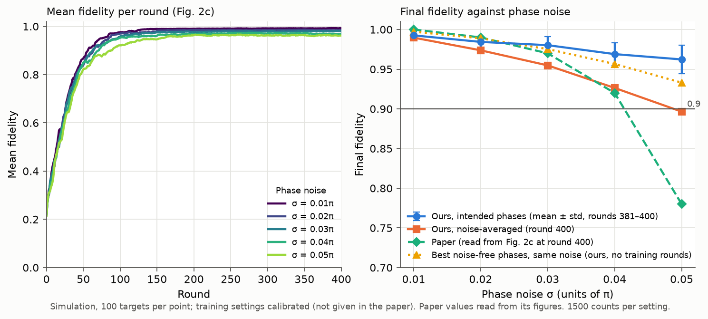
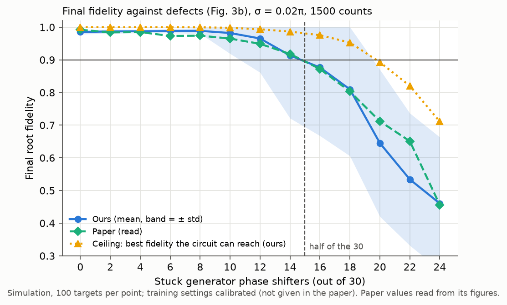
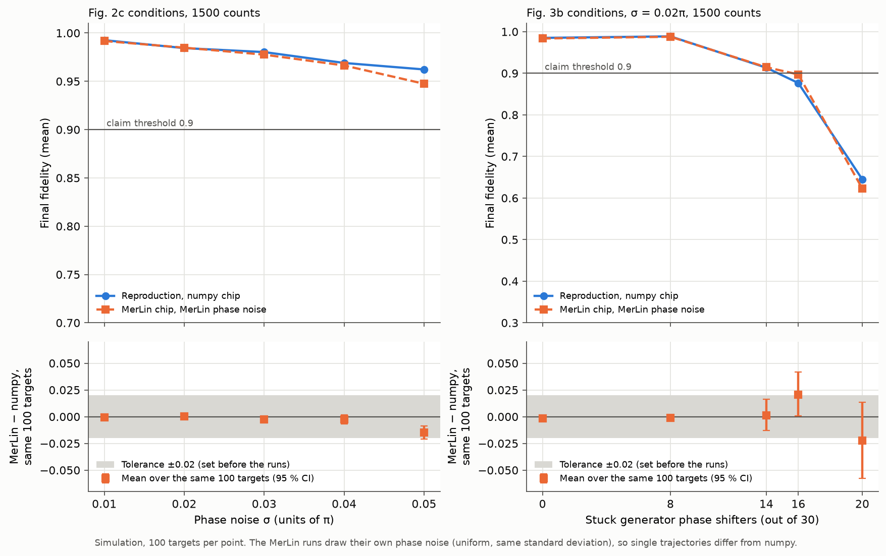

# Quantum Generative Adversarial Learning in Photonics - Reproduction

**Paper.** Wang et al. report the first quantum generative adversarial network
(QGAN) run in photonics: on a programmable silicon chip, it learns a random
two-photon entangled state with a fidelity above 90 %, even with up to half of
the generator's phase shifters stuck (one chip run, then simulations) or with
phase noise up to 0.04π on every phase shifter (simulations). The target state
is known: the paper shows that learning can "prepare high-fidelity quantum
states on defective chips instead of reducing their scale".

**Reproduction.** In simulation, the robustness reproduces: the mean fidelity
over 100 random targets stays above 90 % up to σ = 0.04π and up to 14 of 30
stuck phase shifters (Fig. 2c, Fig. 3b). Up to 10 stuck, the QGAN stays within
0.02 of the best fidelity the defective circuit allows; beyond, the gap widens
(−0.099 at 16 stuck): the training, not the circuit, limits it.

**MerLin.** Built as one MerLin layer (8 modes, 2 photons), the chip gives
identical results with the same noise draws, and both robustness claims still
hold with MerLin's own noise model (5 noise levels, 5 of the 13 defect rates).

## Reference and Attribution

- Paper: "Quantum generative adversarial learning in photonics", Optics Letters
  48(20), 5197-5200 (2023)
- Authors: Yizhi Wang, Shichuan Xue, Yaxuan Wang, Yong Liu, Jiangfang Ding,
  Weixu Shi, Dongyang Wang, Yingwen Liu, Xiang Fu, Guangyao Huang, Anqi Huang,
  Mingtang Deng, Junjie Wu
- DOI: [10.1364/OL.505084](https://doi.org/10.1364/OL.505084)
- Open version: [arXiv:2310.00585v1](https://arxiv.org/abs/2310.00585v1)
- Original repository: none released. The paper states that data are available
  from the authors upon reasonable request.
- License and attribution notes: cite the paper above when using this
  reproduction; see [Citation and License](#citation-and-license).

## Original Paper

Wang et al. report the first quantum generative adversarial network (QGAN) run
in photonics: on a programmable silicon chip, it learns a random two-photon
entangled state with a fidelity above 90 %, even with up to half of the
generator's phase shifters stuck (one chip run, then simulations) or with phase
noise up to 0.04π on every phase shifter (simulations). The target state is
known: the paper shows that learning can "prepare high-fidelity quantum states
on defective chips instead of reducing their scale".

- **Target τ:** a random maximally entangled state of two ququarts
  (four-level systems), path-encoded on 4 + 4 optical modes.
- **Players:** the generator's two 15-phase-shifter meshes (Suppl. Fig. 2(d))
  prepare |g⟩ = (U_s ⊗ U_i) ½ Σ_k |k⟩_s|k⟩_i (Eq. 3); the discriminator's two
  6-phase-shifter circuits (Suppl. Fig. 3) set the projector M (Eq. 4), read as
  the coincidence of both photons at the second ports, so tr[Mρ] is a
  coincidence probability from counts.
- **Game (Eqs. 1–2):** the discriminator maximizes and the generator minimizes
  d = |tr[Mρ] − tr[Mτ]|, with parameter-shift gradients; the fidelity is never
  used in training.
- **Metric:** the fidelity F = |⟨g|τ⟩|, the paper's F (the square root of the
  overlap |⟨g|τ⟩|²).
- **Evidence:** two chip runs (Fig. 2a–b: 16.96 % → 96.02 % in 150 rounds;
  Fig. 3a: 92.11 % with 16 of 30 phase shifters stuck) and simulations with 100
  random targets per point (Fig. 2c phase noise, Fig. 3b stuck phase shifters,
  Suppl. Fig. 9 counts, Suppl. Sec. 6 one stuck phase shifter).

## Reproduction Scope (including Updates and Deviations)

Everything is simulated, with the circuits of Suppl. Figs. 2(d) and 3,
Gaussian phase noise on every phase shifter, 1500 Poisson counts per
measurement setting, and stuck phase shifters.

- **Reproduced:** Fig. 2c and Fig. 3b at the paper's scale (100 targets per
  point), and the two chip runs replayed in simulation. Suppl. Fig. 9 and
  Suppl. Sec. 6 were also run; their tables are in
  [results/comparison_with_paper.md](results/comparison_with_paper.md).
- **Our control, the ceiling:** the best fidelity the defective circuit can
  reach, found by direct optimization knowing τ. The paper compares the QGAN
  with no other method and no classical model outputs a two-photon state; the
  ceiling separates training limits from circuit limits.
- **MerLin adaptation (our addition):** the same chip as one MerLin layer
  (`lib/qgan_merlin.py`) inside the unchanged training game.

Deviations, because the paper does not state these details:

- **Training settings.**
  - Why: the paper gives none; with a fixed number of steps per turn the game
    oscillates (the cost |a − b| has a kink at a = b).
  - What: the generator ends its turn once the measured d ≤ 0.05; step 0.3π,
    up to 20 steps per turn; calibrated at σ = 0.01π on 20 separate targets.
  - How: `training` in `configs/defaults.json`; rule in
    `utils/select_calibration.py`; grid in
    [results/sweep_tables.md](results/sweep_tables.md).
- **How tr[Mτ] is measured** (not described in the paper): the numpy
  simulator measures the known τ with the same noisy discriminator and counts
  as ρ (`lib/qgan.py`); the MerLin chip prepares τ with the generator meshes
  (`lib/qgan_merlin.py`).
- **Random choices** (not stated): Haar-random targets, uniform discriminator
  starts and stuck values, equal stuck counts per circuit, new phase noise at
  every execution (`lib/data.py`). Measuring tr[Mτ] exactly or drawing the
  noise once per round moves the means by at most 0.006
  ([results/sweep_tables.md](results/sweep_tables.md), `phase_noise_variants`).

## Install and How to Run

```bash
pip install -r requirements.txt
```

Quick smoke run (2 targets, 10 rounds, σ = 0.01π, 1500 counts):

```bash
# From the repo root
python implementation.py --paper qgan_quantum_data_photonics
```

Notebook (about 1.5 minutes on a CPU):

```bash
cd papers/qgan_quantum_data_photonics
jupyter execute --inplace --timeout=1200 notebook.ipynb
```

One experiment: each config in `configs/` runs one condition on a block of
target seeds; angles are in units of π.

```bash
# From the repo root
python implementation.py --paper qgan_quantum_data_photonics \
    --config configs/phase_noise_sweep_original.json --phase-noise-pi 0.04
python implementation.py --paper qgan_quantum_data_photonics \
    --config configs/defect_rate_sweep_original.json --defects-per-circuit 8
# The same chip as a MerLin layer, with MerLin's phase-noise model
python implementation.py --paper qgan_quantum_data_photonics \
    --config configs/phase_noise_sweep_merlin.json --phase-noise-pi 0.04 \
    --merlin-noise phase_error
```

Full sweeps: one spec per sweep in `utils/sweep_specs/`; `utils/run_sweep.py`
runs every candidate of a spec into `outdir/sweep_<name>/`. With
`--validator <path to validate_logging.py>` it also checks each run's evidence
files; without it, the sweep log states that the runs are not validated.

```bash
# From the repo root
python papers/qgan_quantum_data_photonics/utils/run_sweep.py \
    papers/qgan_quantum_data_photonics/utils/sweep_specs/phase_noise_sweep.json \
    --sweep-dir papers/qgan_quantum_data_photonics/outdir/sweep_phase_noise_sweep
```

Regenerate `results/` once every sweep has run (`outdir/` is not committed):

```bash
# From the repo root
P=papers/qgan_quantum_data_photonics
python $P/utils/compare_with_paper.py $P/outdir --out $P/results  # comparison_with_paper.*
python $P/utils/plot_results.py $P/outdir --out $P/results        # phase_noise, defect_rate, shot_noise .png
python $P/utils/compare_merlin.py $P/outdir --out $P/results      # merlin_comparison.*
python $P/utils/compare_baselines.py $P/outdir --out $P/results   # baseline_comparison.*
python $P/utils/write_sweep_tables.py $P/outdir --out $P/results/sweep_tables.md
python $P/utils/export_per_target.py $P/outdir --out $P/results/per_target_results.json
# Check the Fig. 3b values in utils/paper_values.py against the paper's vector figure
python $P/utils/read_figure_3b.py data/qgan_quantum_data_photonics/sources/arxiv_2310.00585v1_src/fig3.pdf --check
```

Each run writes `outdir/run_YYYYMMDD-HHMMSS/` with `config_snapshot.json`,
`run.log`, `run_status.json` (status, code commit, seeds, artifact hashes),
`metrics.json` (final fidelity per target) and `trajectories.npz` (per-round
fidelity and d).

## Configuration

- `configs/defaults.json`: smoke settings, every key, and the calibrated
  training settings.
- `configs/<experiment>_original.json`: one overlay per experiment (e.g.
  `phase_noise_sweep`, `defect_rate_sweep`, `oracle_ceiling`).
- `configs/<experiment>_merlin.json`: the chip as a MerLin layer
  (`--backend merlin`); `--merlin-noise injected` reuses the numpy simulator's
  noise draws, `phase_error` uses MerLin's phase-noise model.
- `cli.json`: the authoritative list of paper-specific flags.
- The simulator runs on CPU only.

## Data

Nothing is downloaded: targets are generated numerically, as in the paper. Each
target seed has its own streams for the target, the discriminator start, the
stuck set, the noise and the counts (`lib/data.py`), so every condition sees
the same targets. Seeds: 0–99 for every sweep point, 0–19 for the chip replays
and the training-settings diagnosis, 1000–1019 for the calibration. The
authors' chip data are not public and are not used.

## Results Obtained and Comparison with the Paper

Metric throughout: final fidelity F of the state prepared with the intended
phases (the paper's ρ(θ_G); mean over the last 20 rounds, 10 for the chip
replays), mean over 100 random targets unless stated. Paper values are read
from its figures: Fig. 3b to 0.001 from the vector source
(`utils/read_figure_3b.py`), the others by eye to about ±0.01–0.02. All tables:
[results/comparison_with_paper.md](results/comparison_with_paper.md).

### Reproduction: the robustness reproduces; beyond 10 stuck, training limits it





**Look at:** ours against the paper and the 0.9 line in Fig. 2c and Fig. 3b,
and ours against the ceiling in Fig. 3b.
**Result:** ours stays above 0.9 up to σ = 0.04π (0.969) and up to 14 of 30
stuck (0.913; paper 0.918), and falls more than 0.02 below the ceiling from 12
stuck (−0.028; −0.099 at 16), while the ceiling stays at 0.975 or more up to
16.

- Fig. 2c: up to σ = 0.03π, ours is within 0.01 of the paper (0.993, 0.984,
  0.980); above, it is higher (second limit).
- In Fig. 2c, the orange and yellow curves average F over the phase noise
  instead (ours 0.896, ceiling 0.933 at 0.05π); the paper does not say which of
  the two it plots.
- Fig. 3b: the paper's curve crosses 0.9 between 14 (0.918) and 16 stuck
  (0.872); its claim of above 90 % with half stuck rests on the single chip run
  (92.11 %).
- Beyond the claim's range, ours is 0.067 and 0.117 below the paper at 20 and
  22 stuck, where targets spread widely (std ≈ 0.2).

### MerLin: the chip as one MerLin layer gives identical results



**Look at:** MerLin minus numpy over the same 100 targets, with its 95 %
interval, against the ±0.02 tolerance set before the runs.
**Result:** with the same noise draws every target ends identical; with
MerLin's own noise, 8 of the 10 conditions stay within 0.02 and the two others
(+0.021 at 16 stuck, −0.022 at 20) leave the claims unchanged.

- What: one `QuantumLayer` (from a Perceval circuit) with the entangled
  two-photon input; the 42 phase shifters are inputs set at every execution;
  threshold detection in the `UNBUNCHED` space is exact because each 4-mode
  block holds one photon. The game, gradients, stuck phase shifters and targets
  are unchanged.
- Counts: 1500 Poisson counts from MerLin's exact probabilities; MerLin's own
  sampler is far slower (15.6 s against 0.04 s per 6200 executions on one CPU
  thread, `utils/time_merlin_sampler.py`).
- MerLin's noise (`phase_error`) is uniform with the paper's standard
  deviation, and also hits the chip's preparation of τ.
- Versions: merlinquantum 0.4.2 (reports `merlin.__version__` 0.4.1), Perceval
  1.3.1, CPU, float64. Tables:
  [results/merlin_comparison.md](results/merlin_comparison.md).

## Limitations

1. Simulation only: the paper's two chip runs (Fig. 2a–b, Fig. 3a) are replayed
   in simulation on 20 random targets; nothing ran on hardware.
   - Replays at σ = 0.01π and 0.02π (the chip's noise level is not given):
     0.989 and 0.982 on intact circuits after 150 rounds (chip: 96.02 %),
     0.940 and 0.902 with the 16 stuck phase shifters of Fig. 1(f) after 160
     rounds (chip: 92.11 %).
2. The paper does not give its training settings (step size, steps per turn,
   end-of-turn rule). Ours are calibrated on one point of Fig. 2c; with them,
   the QGAN is more robust than the paper's at σ = 0.04π and 0.05π (0.969 and
   0.962 against ≈0.92 and ≈0.78). A stricter end-of-turn rule brings 0.05π
   down to 0.827 (20 targets): the paper's drop depends on these settings.

   | End-of-turn rule (targets 0–19) | σ = 0.01π | σ = 0.03π | σ = 0.05π |
   |---|---:|---:|---:|
   | d ≤ 0.05 (ours) | 0.993 | 0.980 | 0.965 |
   | d ≤ 0.03 | 0.986 | 0.957 | 0.928 |
   | d ≤ 0.01 | 0.956 | 0.898 | 0.827 |
   | Paper (read, 100 targets) | 1.00 | 0.97 | 0.78 |

   **Look at:** each rule's row against the paper's row.
   **Result:** the stricter the end-of-turn rule, the lower the fidelity at
   every σ: d ≤ 0.01 gives 0.827 at 0.05π, but also 0.956 at 0.01π, so no
   tested setting reproduces the whole Fig. 2c curve.

   Every tested setting: [results/sweep_tables.md](results/sweep_tables.md).

## Tests

```bash
cd papers/qgan_quantum_data_photonics
pytest -q
```

They check the target and noise generation, the circuits against the
supplement's equations, the parameter-shift gradients, noise-free learning,
the ceiling, the CLI, and the MerLin layer against the numpy chip.

## Citation and License

```bibtex
@article{wang2023qgan,
  title   = {Quantum generative adversarial learning in photonics},
  author  = {Wang, Yizhi and Xue, Shichuan and Wang, Yaxuan and Liu, Yong and
             Ding, Jiangfang and Shi, Weixu and Wang, Dongyang and Liu, Yingwen and
             Fu, Xiang and Huang, Guangyao and Huang, Anqi and Deng, Mingtang and
             Wu, Junjie},
  journal = {Optics Letters},
  volume  = {48},
  number  = {20},
  pages   = {5197--5200},
  year    = {2023},
  doi     = {10.1364/OL.505084}
}
```

This folder contains independent code under the repository's license; no code
or data from the authors is included.
