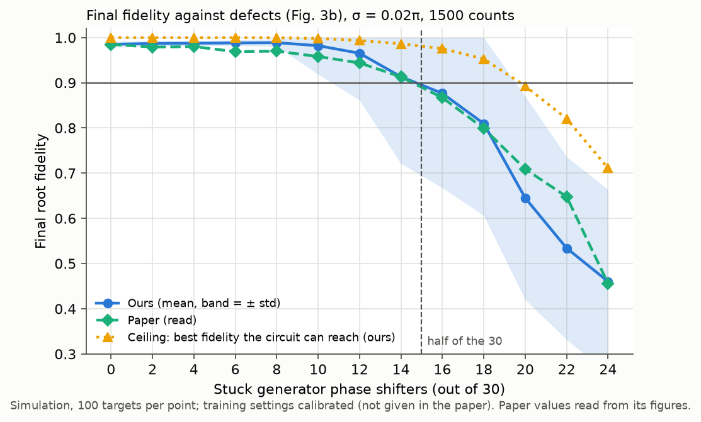
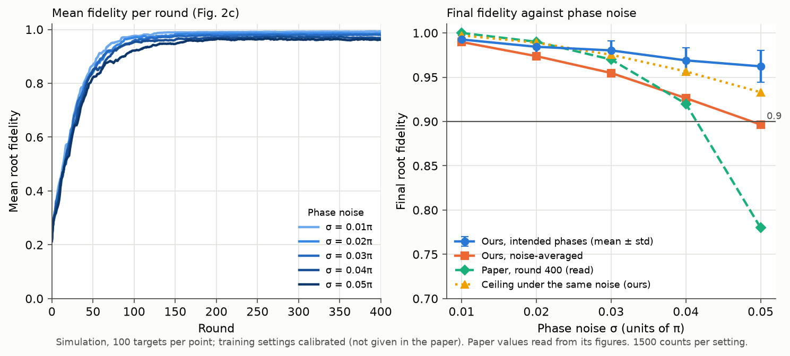
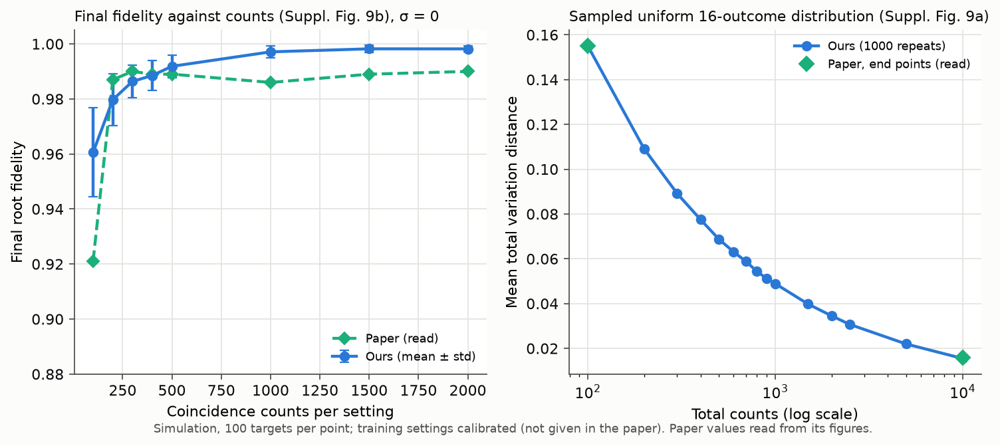
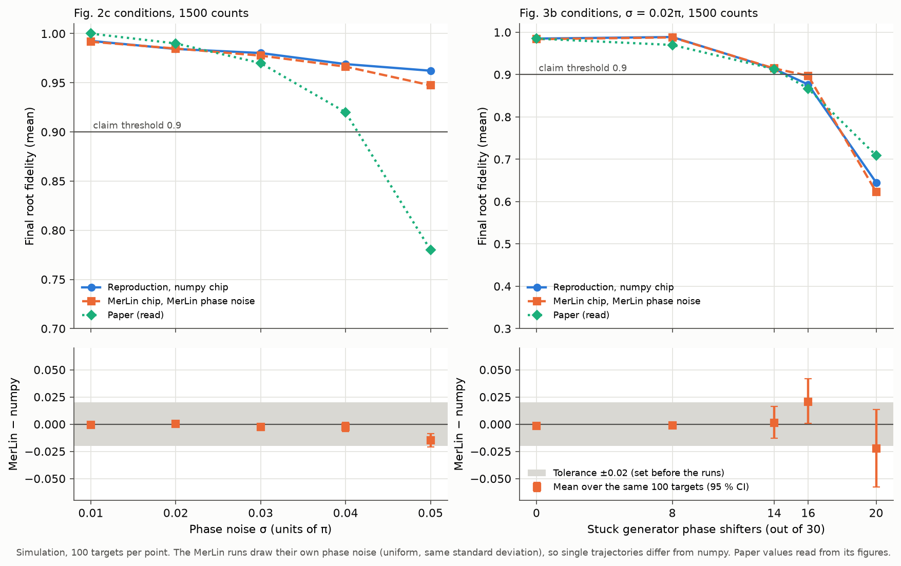

# Quantum Generative Adversarial Learning in Photonics - Reproduction

Status: experiments, MerLin adaptation and comparison with baselines done
(simulation); comparison with the paper below.

## Reference and Attribution

- Paper: "Quantum generative adversarial learning in photonics", Optics Letters
  48(20), 5197-5200 (2023)
- Authors: Yizhi Wang, Shichuan Xue, Yaxuan Wang, Yong Liu, Jiangfang Ding,
  Weixu Shi, Dongyang Wang, Yingwen Liu, Xiang Fu, Guangyao Huang, Anqi Huang,
  Mingtang Deng, Junjie Wu
- DOI: [10.1364/OL.505084](https://doi.org/10.1364/OL.505084)
- Open version: [arXiv:2310.00585v1](https://arxiv.org/abs/2310.00585v1)
- Original repository: none released. The paper states that data are available
  from the authors upon reasonable request.
- License and attribution notes: cite the paper above when using this
  reproduction. This folder contains independent code; no code or data from the
  authors is included.

## Original Paper

The paper trains a quantum generative adversarial network (QGAN) on a photonic
chip to learn quantum data: a random maximally entangled state of two
four-level systems (ququarts), path-encoded on 4 + 4 optical modes. The
generator is a pair of universal 4-mode Mach-Zehnder interferometer meshes; the
discriminator is a quantum projective measurement made of two 4-mode networks.
The paper reports the fidelity of the generated state, and studies robustness to
defective phase shifters and to phase noise.

## Reproduction Scope, Claims, and Deviations

Everything is simulated: no photonic chip is available. The simulator follows
the chip's circuits as drawn in the supplementary document (Suppl. Figs. 2(d)
and 3):
- two 15-phase-shifter meshes for the generator;
- two 6-phase-shifter projection circuits for the discriminator;
- the cost d of Eq. 1 and parameter-shift gradients (shift pi/4);
- Gaussian phase noise on every phase shifter, Poisson coincidence counts (1500
  per measurement setting) and stuck phase shifters.

Experiments run:
- the phase-noise sweep (Fig. 2c);
- the defect-rate sweep (Fig. 3b);
- the shot-noise study (Suppl. Fig. 9);
- the single-defect study (Suppl. Sec. 6);
- the two chip runs replayed in simulation (Figs. 2a-b, 3a);
- our controls, described under [Fair Baselines](#fair-baselines): the best
  fidelity each circuit can reach, a noise-free QGAN, and random projectors in
  place of the trained discriminator.

Claims of the paper, and how they are tested:

- Learning on the chip: the root fidelity rises from 16.96 % to 96.02 % in 150
  rounds (Fig. 2a-b). Tested by replaying the chip run in simulation.
- Phase-noise robustness: above 90 % for σ < 0.04π and below 80 % at 0.05π
  (Fig. 2c, 100 simulations per level).
- Defect tolerance: above 90 % with up to about half of the 30 generator phase
  shifters stuck (Fig. 3b); 92.11 % on the chip with 16 stuck (Fig. 3a).
- Shot noise: fewer counts degrade the learning (Suppl. Fig. 9).
- No crucial phase shifter: one stuck phase shifter has no significant effect
  (Suppl. Sec. 6).
- Not tested:
  - learning without tomography holds by construction (the generator uses only
    measured differences);
  - the first photonic QGAN is a hardware claim and needs the chip.

Deviations and choices, stated because the paper does not give them:

- Training settings: the paper gives no learning rate, number of steps per
  turn or end-of-turn rule. With a fixed number of steps per turn, the game
  oscillates and does not learn: the cost |a - b| has a kink at a = b, where
  the generator keeps taking full-size steps. We let the generator end its turn
  once the measured d falls below a threshold, as the turns of Fig. 2a suggest
  (2-6 steps, ending with a gap of about 0.02-0.04); the step size, steps per
  turn and threshold are calibrated on one condition of Fig. 2c.
- Random choices not stated in the paper: Haar-random targets; uniform
  discriminator starting phases and stuck values; the same number of stuck
  phase shifters in each circuit; new phase noise at every circuit execution.

MerLin adaptation (our addition): the same chip built as a MerLin layer
(`lib/qgan_merlin.py`) replaces the numpy simulator inside the unchanged
training game; see
[Photonic Assessment and MerLin Extension](#photonic-assessment-and-merlin-extension).

## Project Layout

```
papers/qgan_quantum_data_photonics/
├── lib/        # circuits.py (numpy chip), data.py (per-seed inputs), qgan.py (game),
│               # ceiling.py, metrics.py, qgan_merlin.py (MerLin chip), runner.py
├── configs/    # defaults.json and one overlay per experiment
├── utils/      # sweep launcher and specs, comparison and figure scripts
├── tests/
├── results/    # generated tables and figures used in this README
└── outdir/     # raw runs (not committed)
```

## Install and How to Run

### Install dependencies

```bash
pip install -r requirements.txt
```

### Quick smoke run

```bash
# From the repo root: 2 targets, 10 rounds, sigma = 0.01 pi, 1500 counts
python implementation.py --paper qgan_quantum_data_photonics
```

### One experiment

Each config in `configs/` runs one condition on a block of target seeds (one
target per seed). Paper-specific flags are listed in `cli.json`; angles are in
units of pi.

```bash
# From the repo root
python implementation.py --paper qgan_quantum_data_photonics \
    --config configs/phase_noise_sweep_original.json --phase-noise-pi 0.04
python implementation.py --paper qgan_quantum_data_photonics \
    --config configs/defect_rate_sweep_original.json --defects-per-circuit 8
# The same chip as a MerLin layer, with MerLin's phase-noise model
python implementation.py --paper qgan_quantum_data_photonics \
    --config configs/phase_noise_sweep_merlin.json --phase-noise-pi 0.04 \
    --merlin-noise phase_error
```

### Sweeps

`utils/run_sweep.py` runs every candidate of a spec in `utils/sweep_specs/`
one after the other, checks each run's evidence files with the logging
validator given by `--validator`, and writes `sweep_status.json`, `sweep.log`
and `sweep_summary.json` in the sweep folder.

```bash
# From the repo root
python papers/qgan_quantum_data_photonics/utils/run_sweep.py \
    papers/qgan_quantum_data_photonics/utils/sweep_specs/phase_noise_sweep.json \
    --sweep-dir papers/qgan_quantum_data_photonics/outdir/sweep_phase_noise \
    --validator <path to validate_logging.py>
```

### Output directory

Each run writes a timestamped folder under the base `outdir` (default:
`outdir/`):

```
outdir/run_YYYYMMDD-HHMMSS/
├── config_snapshot.json   # Resolved configuration
├── run.log                # Run log
├── run_status.json        # Status, code commit, dataset identity, artifact hashes
├── metrics.json           # Summary metrics (root fidelity, convergence round, d)
└── trajectories.npz       # Per-round, per-seed fidelity and d (ceiling.npz for the ceiling)
```

## Configuration

- `configs/defaults.json`: smoke settings and every key, with the calibrated
  training settings (step 0.3π, up to 20 steps per turn, generator stop at
  d ≤ 0.05) and the numpy chip simulator.
- `configs/<experiment>_original.json`: one overlay per planned experiment
  (`phase_noise_sweep`, `defect_rate_sweep`, `shot_noise_sweep`,
  `single_defect`, `single_defect_position`, `intact_chip_emulation`,
  `defective_chip_emulation`, `oracle_ceiling`, `oracle_ceiling_chip`,
  `fixed_discriminator`, `noise_free_reference`, `calibration`,
  `minimal_learning`, `minimal_learning_noisy`, `shot_noise_tvd`).
- `configs/<experiment>_merlin.json` (`smoke`, `phase_noise_sweep`,
  `defect_rate_sweep`): the chip as a MerLin layer (`--backend merlin`);
  `--merlin-noise injected` reuses the numpy simulator's noise draws,
  `phase_error` uses MerLin's phase-noise model.
- `cli.json`: paper-specific CLI arguments and the config keys they change.
- The simulator runs on CPU only (`--device cpu`).

## Data

Nothing is downloaded. As in the paper, the learning targets are random
maximally entangled two-ququart states generated numerically. Each run draws its
target, the discriminator's initial phases, the stuck phase-shifter values and
the noise from its seed, so no data file is stored. The paper does not state the
target distribution; we draw targets from the Haar measure (our choice), which
covers every maximally entangled two-ququart state.

Generation (`lib/data.py`):
- Each target seed gets its own `numpy.random.SeedSequence`, with independent
  streams for the target, the discriminator start, the stuck set, the phase
  noise and the counts.
- A seed therefore gives the same target and stuck set at every noise level and
  count budget, so conditions are compared on the same targets.
- Seeds:
  - 0–99 for every sweep point;
  - 0–19 for the chip replays and for each single-position defect check;
  - 1000–1019 for the calibration.
- Each run records its seeds and a SHA-256 of its targets and stuck sets in
  `run_status.json`.

The authors' measured chip data are not public (available from the authors on
request) and are not used: the chip runs (Fig. 2a-b, Fig. 3a) are emulated in
simulation and compared with the values the paper reports. If these data are
obtained later, they go under
`data/qgan_quantum_data_photonics/authors_measured_data/`.

## Results Obtained and Comparison with the Paper

Scope: simulation only. Each point averages 100 random targets (seeds 0–99) with
1500 coincidence counts per measurement setting unless stated (the chip
replays, the per-position defect check and the training-protocol diagnosis use
20 targets). Metric: root
fidelity |⟨g|τ⟩|, the paper's F, averaged over the last 20 rounds of a run;
values are mean ± standard deviation over targets. Training settings (step
0.3π, up to 20 steps per turn, generator stops at a measured d ≤ 0.05) were
calibrated on one point of Fig. 2c (20 separate targets) because the paper
gives none. Paper values
are read from its figures (about ±0.01–0.02) or quoted from its text.
Generated tables: [results/comparison_with_paper.md](results/comparison_with_paper.md);
every candidate of every sweep: [results/sweep_tables.md](results/sweep_tables.md).

Summary (final root fidelity; "within" means |difference| ≤ 0.03, the tolerance
set before the runs for Fig. 2c and used here for every item):

| Paper item | Claim tested | Paper value | Reproduced value | Difference | Metric agreement | Trend agreement | Claim support | Targets | Comment |
|---|---|---:|---:|---:|---|---|---|---:|---|
| Fig. 2a–b (chip run) | Learning on the chip | 0.9602 | 0.989 ± 0.004 (σ = 0.01π); 0.982 ± 0.009 (0.02π) | +0.029; +0.022 | N/A: one chip run against a simulation | yes: above 0.9 within 150 rounds | supported in simulation | 20 | Chip noise level unknown, bracketed by two σ |
| Fig. 2c, σ ≤ 0.03π | Phase-noise robustness | 1.00, 0.99, 0.97 | 0.993, 0.984, 0.980 | −0.007 to +0.010 | within | yes | supported | 100 per σ | The σ = 0.01π speed was used for the calibration |
| Fig. 2c, σ = 0.04π, 0.05π | Phase-noise robustness | 0.92; 0.78 | 0.969 ± 0.014; 0.962 ± 0.018 | +0.049; +0.182 | no | partial: falls with σ but stays above 0.90 | partially supported | 100 per σ | The drop depends on the unpublished training protocol |
| Fig. 3a (chip run, 16 / 30 stuck) | Defect tolerance | 0.9211 | 0.940 ± 0.091 (σ = 0.01π); 0.902 ± 0.127 (0.02π) | +0.019; −0.019 | N/A: one chip run against a simulation | yes | supported in simulation | 20 | Same stuck positions as Fig. 1(f) |
| Fig. 3b, 0–18 / 30 stuck | Defect tolerance | 0.985 to 0.799 | 0.985 to 0.810 | +0.000 to +0.024 | within | yes | supported: ≥ 0.90 up to 14 / 30 | 100 per rate | 0.913 at 14 / 30 as in the paper |
| Fig. 3b, 20–24 / 30 stuck | Defect tolerance | 0.709, 0.648, 0.456 | 0.645, 0.534, 0.460 | −0.064, −0.114, +0.004 | no at 20 and 22 | yes: sharp drop beyond half | beyond the claim's range | 100 per rate | Large spread over targets (std ≈ 0.2) |
| Suppl. Fig. 9a | Shot noise (sampling error) | 0.155; 0.016 | 0.1551; 0.0155 | +0.0001; −0.0005 | within | yes | supported | 1000 repeats | Total variation distance at 100 and 10,000 counts |
| Suppl. Fig. 9b | Shot noise (learning) | 0.921 at 100 counts; 0.986–0.990 from 200 | 0.961 at 100; 0.980–0.998 from 200 | +0.040 at 100; −0.007 to +0.011 from 200 | no at 100 counts | yes: rises with counts | partially supported | 100 per budget | Convergence rounds not comparable (our rule) |
| Suppl. Sec. 6 | No crucial phase shifter | 0.9833 ± 0.0700 | 0.987 ± 0.006 | +0.004 | within | yes: no effect | supported | 100 | 0.985 ± 0.007 without defect; each of the 15 positions gives 0.981–0.990 |

### Defects: the fidelity stays above 90 % up to about half of the generator phase shifters stuck



The reproduced curve follows Fig. 3b (σ = 0.02π) within 0.025, except at 20
and 22 stuck phase shifters, where ours is 0.064 and 0.114 lower. The ceiling, the best
fidelity the defective circuit can reach (our control, found by direct
optimization with knowledge of τ), stays far above the QGAN beyond 12 stuck
phase shifters: the decline comes from learning, not from what the circuit can
express.

| Stuck / 30 | Ours | Paper (read) | Ceiling |
|---:|---:|---:|---:|
| 0 | 0.985 ± 0.007 | 0.985 | 1.000 |
| 2 | 0.987 ± 0.006 | 0.979 | 1.000 |
| 4 | 0.988 ± 0.005 | 0.980 | 1.000 |
| 6 | 0.988 ± 0.006 | 0.969 | 1.000 |
| 8 | 0.989 ± 0.008 | 0.970 | 1.000 |
| 10 | 0.982 ± 0.063 | 0.958 | 0.998 |
| 12 | 0.965 ± 0.104 | 0.944 | 0.994 |
| 14 | 0.913 ± 0.192 | 0.913 | 0.986 |
| 16 | 0.877 ± 0.209 | 0.867 | 0.975 |
| 18 | 0.810 ± 0.204 | 0.799 | 0.953 |
| 20 | 0.645 ± 0.225 | 0.709 | 0.893 |
| 22 | 0.534 ± 0.203 | 0.648 | 0.820 |
| 24 | 0.460 ± 0.203 | 0.456 | 0.711 |

### Phase noise: above 90 % for σ < 0.04π, but our QGAN does not show the paper's drop at 0.05π



Up to σ = 0.03π the final values match Fig. 2c within about 0.01, but our QGAN
reaches 0.9 sooner (64 and 63 rounds against ≈79 and ≈159 at 0.02π and 0.03π).
At 0.04π and 0.05π it is also more robust than the paper's. Neither computing tr[Mτ] exactly nor drawing
the noise once per round changes this (≤ 0.006). Changing the unpublished
training settings does (diagnosis on 20 targets, one run per setting): a
generator that stops only at d ≤ 0.01 drops to 0.827 ± 0.069 at 0.05π (0.782
averaged over noise draws, the paper's value) but is slower and lower at small
σ. No tested setting reproduces the whole curve.

| σ | Ours | Ours, noise-averaged | Paper (read) | Round the mean reaches 0.9 (ours / paper) |
|---|---:|---:|---:|---:|
| 0.01π | 0.993 ± 0.004 | 0.990 | 1.00 | 57 / 59 |
| 0.02π | 0.984 ± 0.007 | 0.974 | 0.99 | 64 / 79 |
| 0.03π | 0.980 ± 0.011 | 0.955 | 0.97 | 63 / 159 |
| 0.04π | 0.969 ± 0.014 | 0.926 | 0.92 | 71 / 245 |
| 0.05π | 0.962 ± 0.018 | 0.896 | 0.78 | 88 / never |

The σ = 0.01π speed was used for the calibration, so it is not independent
evidence. "Ours" uses the phases the generator intends to set; "noise-averaged"
averages the fidelity over 100 phase-noise draws.

### Shot noise and the other checks



| Counts | 100 | 200 | 300 | 500 | 1000 | 2000 |
|---|---:|---:|---:|---:|---:|---:|
| Ours (σ = 0) | 0.961 | 0.980 | 0.986 | 0.992 | 0.997 | 0.998 |
| Paper (read) | 0.921 | 0.987 | 0.990 | 0.989 | 0.986 | 0.990 |

- Sampling error (Suppl. Fig. 9a): total variation distance 0.155 at 100 counts and 0.0155 at 10,000 (paper ≈0.155 and ≈0.016).
- Chip runs replayed in simulation (20 targets): intact circuits 0.989 ± 0.004 (σ = 0.01π) and 0.982 ± 0.009 (0.02π) after 150 rounds, against 96.02 % on the chip; with the 16 stuck phase shifters of Fig. 1(f), 0.940 ± 0.091 and 0.902 ± 0.127 after 160 rounds, against 92.11 %.
- One stuck phase shifter per circuit (Suppl. Sec. 6): 0.987 ± 0.006 (paper 98.33 ± 7.00 %); each of the 15 positions alone (20 targets per position) gives 0.981–0.990, so none is critical.

## Fair Baselines

Up to 10 stuck phase shifters and σ = 0.02π, the QGAN reaches what the chip
allows.

The paper claims robustness, not an advantage over another method, and it
compares the QGAN only with itself under weaker noise. No classical generative
model outputs a two-photon state. We therefore compare the QGAN with other ways
of setting the same chip, on the same 100 targets. Two results count as tied
when their mean paired difference is at most 0.02, the tolerance of our earlier
rules.

- **Ceiling** (the best fidelity the chip can reach, found knowing τ):
  - The QGAN is tied with it up to 10 of 30 stuck phase shifters and, averaged
    over the noise, up to σ = 0.02π.
  - Beyond that, the QGAN is clearly lower: −0.028 at 12 stuck, −0.099 at 16,
    and −0.021 to −0.037 from σ = 0.03π. Learning, not the circuit, sets the
    limit.
- **Noise-free QGAN** (σ = 0, exact probabilities):
  - It reaches 0.990 ± 0.003 after 400 rounds.
  - Phase noise costs at most 0.010 up to σ = 0.03π, then 0.021 at 0.04π and
    0.028 at 0.05π.
  - 100 counts cost 0.030; 200 counts or more cost at most 0.011.
  - Without any noise, the game ends at d = 0.044, just under the generator's
    stop threshold (0.05). This is why slightly noisy runs end higher, for
    example 0.998 with 1500 counts and σ = 0.
- **Random projectors** in place of the trained discriminator: the final
  fidelity is 0.191 lower (95 % interval 0.152–0.232, σ = 0.02π).

No quantum advantage is claimed or tested. Tables and run times:
[results/baseline_comparison.md](results/baseline_comparison.md).

## Photonic Assessment and MerLin Extension

The chip as a MerLin layer gives the same results.



The paper is already linear optics, so MerLin carries its chip element for
element (translation status: MerLin implementation, `MERLIN_IMPLEMENTATION`).
One MerLin layer holds the 8 modes and the 2 photons of the entangled input
state; the 42 phase shifters are inputs set at every execution; detection is
threshold detection in MerLin's `UNBUNCHED` space, exact here because each
4-mode block holds one photon. The training game, the parameter-shift
gradients, the 1500 Poisson counts (drawn from MerLin's probabilities), the
stuck phase shifters and the targets are unchanged, so the role the adaptation
must preserve, the game on an imperfect chip and its robustness, can be tested
directly.

- Same noise draws as the numpy simulator (σ = 0.01π and 0.05π, and 16 of 30
  stuck): every target ends with the identical fidelity.
- MerLin's own phase noise (uniform, same standard deviation as the paper's
  Gaussian, also on the chip's preparation of the target that the discriminator
  measures): the fidelity stays above 90 % for σ < 0.04π and up to 14 of 30
  stuck phase shifters, as with numpy (top panels). The bottom panels show
  MerLin minus numpy over the same 100 targets with its 95 % interval; the grey
  band is the ±0.02 tolerance set before the runs. MerLin is 0.015 lower at
  0.05π. At 16 and 20 stuck the differences (+0.021 [+0.001, +0.042] and
  −0.022 [−0.058, +0.013]) come mostly from targets whose runs end far apart:
  15 and 50 targets differ by more than 0.1 and carry +0.017 and −0.022 of
  them, where the spread over targets is large (std ≈ 0.2).

Rejected mappings: a generic MerLin interferometer (it loses the paper's
stuck-phase-shifter positions) and training by automatic differentiation (it
removes the count and phase noise from the gradients that the robustness claims
are about). Confidence: high for the equivalence; medium for MerLin's noise
model (one run per point, and the noise distribution and the noisy target
preparation change together). Tables:
[results/merlin_comparison.md](results/merlin_comparison.md).

## Hardware-Aware Settings

Every MerLin run (simulation, no hardware execution):

| Field | Value |
|---|---|
| Simulator | MerLin `QuantumLayer` (merlinquantum 0.4.2, which reports `merlin.__version__` 0.4.1, the label stored in the run records) built from a Perceval 1.3.1 circuit, CPU, float64 |
| Computation space | `UNBUNCHED` |
| Detector model | Threshold. Each 4-mode block holds one photon, so this equals number resolution |
| Photons / modes | 2 / 8 (signal 0–3, idler 4–7) |
| Input state | ½ (\|1000 1000⟩ + \|0100 0100⟩ + \|0010 0010⟩ + \|0001 0001⟩), main text Eq. 3 |
| Encoding | 42 phase shifters set at every execution: 2 × 15 generator, 2 × 6 discriminator |
| Measurement | Output probabilities; tr[Mρ] is the probability of port 2 on both sides, estimated from counts |
| Postselection | Coincidences, one photon per block (no probability leaves the 16 patterns) |
| Shot count | 1500 Poisson counts per setting, drawn from MerLin's exact probabilities (MerLin's own sampler: 15.6 s against 0.03 s per 6200 executions) |
| Gradients | Parameter shift (±π/4); every shifted term is a separate noisy execution |
| Losses and detectors | Lossless circuit, ideal detectors, pure input state (assumed) |
| Seeds | Targets 0–99; torch seed 0 for MerLin's phase noise |
| Wall-clock per run (100 targets) | 4.0–4.4 min for 400 rounds, 18.0–28.6 min for 2000 rounds (3 runs sharing a laptop CPU, one thread each) |

## Limitations

- Simulation only: the chip results (Figs. 2a–b, 3a) are replayed in simulation with an unknown chip noise level.
- The training protocol is ours (calibrated): the paper gives no step size, steps per turn or end-of-turn rule, and the high-noise results depend on them.
- The paper's "convergence round" is undefined; our rule is not comparable on long runs, so convergence speed is compared through the round at which the mean fidelity reaches 0.9.
- The MerLin adaptation simulates the same ideal chip (lossless, ideal detectors, pure input state); it is not a hardware validation. It covers Fig. 2c and 5 of the 13 defect rates of Fig. 3b.
- One run per condition: the intervals cover the spread over targets, not repeated noise draws on the same targets. The discriminator ablation covers one condition (σ = 0.02π, intact circuits).

## Tests

Run tests from inside the paper folder:

```bash
cd papers/qgan_quantum_data_photonics
pytest -q
```

The 41 tests check:
- the target and noise generation (normalization, entanglement, Haar moments,
  per-seed streams, defects, counts);
- the circuits against the supplement's equations, and the exact
  parameter-shift gradients;
- noise-free learning and the ceiling;
- the CLI and the runtime wiring;
- the MerLin layer against the numpy chip;
- that the noise-free baseline config differs from the Fig. 2c protocol only
  in its noise.

## Citation and License

```bibtex
@article{wang2023qgan,
  title   = {Quantum generative adversarial learning in photonics},
  author  = {Wang, Yizhi and Xue, Shichuan and Wang, Yaxuan and Liu, Yong and
             Ding, Jiangfang and Shi, Weixu and Wang, Dongyang and Liu, Yingwen and
             Fu, Xiang and Huang, Guangyao and Huang, Anqi and Deng, Mingtang and
             Wu, Junjie},
  journal = {Optics Letters},
  volume  = {48},
  number  = {20},
  pages   = {5197--5200},
  year    = {2023},
  doi     = {10.1364/OL.505084}
}
```

This folder contains independent code under the repository's license; no code
or data from the authors is included.
